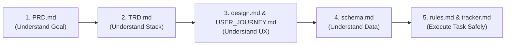

# DownLink — High-Speed Media Extraction Monorepo

> **DownLink** is a modern, high-speed, privacy-first media downloader and transcoding web application built with **Next.js 16**, **React 19**, **Turborepo**, **yt-dlp**, and **ffmpeg**.

---

## 📚 Project Documentation Package (Single Source of Truth)

This repository includes a complete, battle-tested documentation suite designed specifically for **AI-assisted development ("vibe coding")** and team collaboration. Every document in `/docs/` governs a specific architectural domain to prevent hallucinations, inconsistent implementations, and scope creep.

```
Downloader/
├── docs/
│   ├── PRD.md                  # 1. Product Requirements Document (What & Why)
│   ├── TRD.md                  # 2. Technical Requirements Document (How & Architecture)
│   ├── USER_JOURNEY.md         # 3. User Journey & Screen Flows (UX & Edge Cases)
│   ├── design.md               # 4. UI/UX Design System (Tokens, Themes, Components)
│   ├── schema.md               # 5. Database Schema & Data Models (Task Store, Storage)
│   ├── IMPLEMENTATION_PLAN.md  # 6. Development Roadmap & Phased Build Order
│   ├── tracker.md              # 7. Real-Time Project Progress & Task Tracker
│   └── rules.md                # 8. AI Development Rules & Security Guardrails
└── README.md                   # Repository Entry Point & Documentation Guide
```

---

## 📖 Purpose of Each Document

| File | Purpose | Key Contents |
|---|---|---|
| [`docs/PRD.md`](docs/PRD.md) | Defines product vision, requirements, and scope | Problem statement, user personas, P0/P1/P2 feature priority, MVP boundaries, acceptance criteria. |
| [`docs/TRD.md`](docs/TRD.md) | Specifies technical architecture and technology choices | Turborepo setup, Next.js App Router, yt-dlp child processes, streaming pipelines, CORS, hosting. |
| [`docs/USER_JOURNEY.md`](docs/USER_JOURNEY.md) | Maps user workflows and system state transitions | Screen layouts, Mermaid user flowcharts, cold-start hints, network drop recoveries, empty states. |
| [`docs/design.md`](docs/design.md) | Establishes the visual identity and UI design tokens | Cybernetic dark mode, exact HEX colors (`#10b981`, `#0a0a0b`), typography, spacing, component states. |
| [`docs/schema.md`](docs/schema.md) | Formalizes data models, tasks, and storage lifecycles | In-memory `Task` entity, `localStorage` history schema, file eviction TTL, V2 PostgreSQL schema. |
| [`docs/IMPLEMENTATION_PLAN.md`](docs/IMPLEMENTATION_PLAN.md) | Prescribes strict task sequencing and dependencies | 8 phased development milestones, build orders, definition of done (DoD), verification checks. |
| [`docs/tracker.md`](docs/tracker.md) | Live progress scorecard and dependency log | Master task table (Done, In Progress, Blocked), milestone status, changelog, next actions. |
| [`docs/rules.md`](docs/rules.md) | Binding constraints for AI models and developers | Safe `spawn` execution, SSRF prevention, cookie protection, no unsolicited refactors, coding styles. |

---

## 🧭 Recommended Reading Order

When onboarding as a developer or initiating an AI coding session, read the documents in this exact sequence:



1. **`PRD.md`** — Understand what problem DownLink solves, who uses it, and what is strictly in/out of scope.
2. **`TRD.md`** — Understand how the monorepo, backend extraction engine, and frontend communicate.
3. **`USER_JOURNEY.md` & `design.md`** — Learn the user workflows, visual tokens, and responsive component requirements.
4. **`schema.md`** — Understand how tasks are structured, tracked, streamed, and pruned.
5. **`rules.md` & `tracker.md`** — Review the security guidelines and pick up the next task from the tracker.

---

## 🤖 How Developers and AI Coding Assistants Should Use This

### For AI Coding Assistants ("Vibe Coding")
1. **Context Loading:** Before writing any code, load the relevant `.md` file in `docs/` corresponding to your assigned task.
2. **Check the Tracker First:** Check `docs/tracker.md` to confirm the status of prerequisites. Never attempt a task if its dependencies are incomplete.
3. **Strict Constraint Adherence:**
   - Follow the design tokens in `docs/design.md` (e.g., do not invent purple buttons or light-mode themes).
   - Follow the process execution security rules in `docs/rules.md` (e.g., always use `spawn` with array arguments; never use `exec`).
   - Follow the API signatures in `docs/TRD.md`.
4. **Update Progress:** When completing a task, immediately update `docs/tracker.md` to reflect the new state.

### For Human Developers
- Use `docs/` as the blueprint for code reviews and architectural decisions.
- When delegating work to an AI agent, reference specific documents (e.g., *"Implement TASK-28 according to the eviction policy in docs/schema.md and the rules in docs/rules.md"*).

---

## 🛠️ Monorepo Quick Start

### 1. Prerequisites
- **Node.js:** v20.x or v24.x
- **Python 3:** Required for `yt-dlp`
- **ffmpeg:** Required for merging video and audio streams

### 2. Install Dependencies
```bash
npm install
```

### 3. Run Development Mode
Start both frontend and backend concurrently with Turborepo:
```bash
npm run dev
```
- Frontend: `http://localhost:3000`
- Backend API: `http://localhost:10000`

### 4. Build & Lint All Workspaces
```bash
npm run lint
npm run build
```

---

## 🔄 Maintaining & Updating Documentation

As DownLink evolves:
1. **Never let code drift from documentation:** If an API endpoint signature changes, update `docs/TRD.md` and `docs/schema.md` in the same pull request.
2. **Changelog Tracking:** Whenever a milestone is reached or a significant architectural shift occurs, record it under the Recent Changelog section of `docs/tracker.md`.
3. **Expanding to V2:** When beginning Version 2.0 (User Auth, PostgreSQL, Cloud Storage), move those features from "Future Roadmap" in `docs/PRD.md` and `docs/IMPLEMENTATION_PLAN.md` into active milestones in `docs/tracker.md`.
