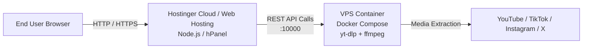

# 🚀 Hostinger Deployment Guide: DownLink Universal Downloader

This guide details how to deploy **DownLink** using the recommended split-architecture:
- **Frontend:** Hosted on **Hostinger Cloud / Web Hosting** (via hPanel Node.js application manager).
- **Backend:** Containerized on a **VPS (Hostinger VPS or Cloud VPS)** running Docker (`yt-dlp` and `ffmpeg` engine).
- **Communication:** Direct IP/port (`http://<VPS_IP>:10000`) for testing, with optional SSL subdomain setup.

---

## 🏗️ Architecture Overview



---

## 🛠️ Step 1: Deploy the Backend on your VPS

Because Hostinger Shared/Cloud Web Hosting does not permit installing OS-level binary tools (`ffmpeg` and `yt-dlp`), the backend runs in a hardened Docker container on your VPS.

### 1.1 Connect to your VPS
```bash
ssh root@<YOUR_VPS_IP>
```

### 1.2 Install Docker & Docker Compose (if not already installed)
On Ubuntu / Debian:
```bash
apt update && apt install -y docker.io docker-compose-v2 curl
systemctl enable --now docker
```

### 1.3 Clone Repository & Start the Backend
```bash
# Clone repository
git clone https://github.com/<YOUR_GITHUB_USERNAME>/Downloader.git
cd Downloader

# Start backend container via Docker Compose
docker compose up -d --build
```

### 1.4 Allow Traffic Through Firewall
Ensure port `10000` is open for incoming connections:
```bash
# UFW (Ubuntu/Debian)
ufw allow 10000/tcp
ufw status
```

### 1.5 Verify Backend Health
Test that the backend is responding from your local computer or terminal:
```bash
curl http://<YOUR_VPS_IP>:10000/api/status
```
Expected output:
```json
{"tasks":[]}
```

---

## 📦 Step 2: Package and Deploy Frontend to Hostinger

We have automated the Next.js standalone bundling so you don't need to manually configure dependencies in hPanel.

### 2.1 Package the Frontend on your Local Machine
Run the automated packager script, providing your VPS IP and port:

```bash
npm run package:hostinger -- --api-url=http://<YOUR_VPS_IP>:10000
```

> **Note:** If you later attach a domain (e.g. `https://api.yourdomain.com`), simply re-run:
> `npm run package:hostinger -- --api-url=https://api.yourdomain.com`

This script automatically creates a production-ready archive at the root of the project:  
📁 **`hostinger-frontend.zip`** (contains `server.js`, bundled production `node_modules`, `.next`, `public`, `.env.production`, and `.htaccess`).

---

### 2.2 Upload to Hostinger hPanel

1. Log into your **Hostinger Control Panel (hPanel)**.
2. Go to **Websites** ➔ click **Manage** on your domain.
3. Open **File Manager** (Files ➔ File Manager).
4. Navigate into your website root:
   - For main domain: `public_html/`
   - For subdomain: `domains/subdomain.yourdomain.com/public_html/`
5. Click **Upload** (top right icon) ➔ select `hostinger-frontend.zip`.
6. Right-click `hostinger-frontend.zip` ➔ select **Extract** ➔ extract directly into `public_html`.
7. Once extracted, you should see:
   - `server.js`
   - `.next/`
   - `public/`
   - `node_modules/`
   - `package.json`
   - `.htaccess`
   - `.env.production`
8. (Optional) You can delete the uploaded `.zip` file to save disk space.

---

### 2.3 Configure Node.js in Hostinger hPanel

1. In hPanel, use the search bar or navigate to **Advanced** ➔ **Node.js** (or **Websites** ➔ **Node.js**).
2. Click **Create Application** (or Edit existing):
   - **Node.js Version:** `20.x` (or `22.x` LTS).
   - **Application Mode:** `Production`.
   - **Application Root:** `public_html` (or your subdomain folder).
   - **Application Startup File:** `server.js`.
3. In **Environment Variables** (if available in your hPanel):
   - Add: `PORT=3000`
   - Add: `NODE_ENV=production`
4. Click **Save** / **Restart Application**.

---

## 🔒 Step 3: CORS & Network Verification

1. In your backend `docker-compose.yml` on the VPS, verify `CORS_ALLOW_ORIGIN`:
   - During direct IP testing: keep `CORS_ALLOW_ORIGIN=*` (already configured by default).
   - Once your Hostinger domain is active: update `CORS_ALLOW_ORIGIN=https://your-hostinger-domain.com` and run `docker compose up -d`.
2. Visit your Hostinger website in your browser: `http://your-hostinger-domain.com` (or preview URL).
3. Paste a test video URL (e.g. YouTube or Instagram).
4. Verify that format detection, live progress streaming, and download file generation succeed.

---

## 💡 Troubleshooting & Common Questions

### 1. `server.js` fails to start on Hostinger
- Ensure you extracted the files so `server.js` is at the **top level** of `public_html/`, not nested in an extra folder.
- Check the Node.js logs in hPanel under **Node.js ➔ Application Logs**.

### 2. Frontend shows "Network Error" or "Failed to connect to backend"
- Verify that your VPS firewall allows port `10000` (`ufw allow 10000/tcp`).
- If your Hostinger frontend uses `https://`, modern browsers block mixed-content requests to `http://<VPS_IP>:10000`. You must either:
  - Access the frontend via `http://` for initial IP testing, OR
  - Point a DNS subdomain (e.g. `api.yourdomain.com`) to your VPS IP and run Certbot/Nginx on the VPS for SSL.

### 3. YouTube Download Restrictions
- To enable authenticated YouTube downloads (prevent bot detection), place your exported `youtube.cookies.txt` into the `./secrets/` directory on your VPS. The Docker container mounts this directory automatically.
