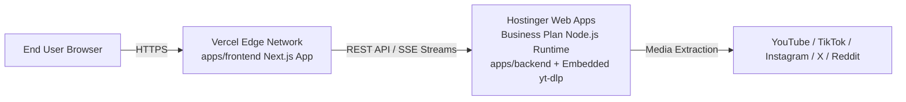

# 🚀 Deployment Guide: Frontend on Vercel + Backend on Hostinger Web Apps

This guide details how to deploy **DownLink** with **$0 additional cost** using:
- **Frontend:** Hosted on **Vercel** (Global edge CDN, automated Next.js builds, free SSL, zero maintenance).
- **Backend:** Hosted on your active **Hostinger Business Plan** via **Web Apps** (Node.js standalone runtime with an embedded standalone Linux `yt-dlp` executable).
- **Interconnection:** Vercel frontend communicates with the Hostinger Web App backend over HTTPS via `NEXT_PUBLIC_API_BASE_URL`.

---

## 🏗️ Architecture Overview



---

## 📦 Part 1: Deploy Backend on Hostinger Web Apps

Because Hostinger Web Apps run in a containerized Node.js environment without root/`apt-get` access, we bundle a self-contained Linux PyInstaller binary of `yt-dlp` right inside `bin/yt-dlp`.

### Option A: 1-Click Upload with `hostinger-backend.zip` (Easiest)

1. **Verify your backend package:**
   The pre-packaged standalone backend archive `hostinger-backend.zip` (17.44 MB) is ready in your project root:
   ```bash
   # Re-generate at any time by running:
   npm run package:backend
   ```

2. **Create Web App in Hostinger hPanel:**
   - In your Hostinger dashboard, go to **Websites** ➔ **Web Apps** (left sidebar).
   - Click the purple **+ Create site** button.
   - Choose your domain or subdomain (e.g. `api.yourdomain.com` or a free Hostinger preview domain like `downlink-api.hostingersite.com`).

3. **Upload Files:**
   - In hPanel, go to **Files** ➔ **File Manager** for your backend site.
   - Open the application folder (`public_html` or domain root).
   - Click **Upload** ➔ upload `hostinger-backend.zip`.
   - Right-click `hostinger-backend.zip` ➔ click **Extract** (extract directly into root).
   - Ensure the extracted files contain:
     - `server.js`
     - `bin/yt-dlp`
     - `.next/`
     - `node_modules/`
     - `package.json`
     - `.env.production`
     - `.htaccess`

4. **Configure Node.js Runtime:**
   - In hPanel, locate **Node.js** settings for this site.
   - Set **Node.js Version:** `20.x` (or `22.x`).
   - Set **Application Startup File:** `server.js`.
   - Set **Application Root:** `public_html`.
   - Click **Start** or **Restart Application**.

5. **Verify Backend Health:**
   Open in your browser or run in terminal:
   ```bash
   curl -i https://<your-backend-hostinger-url>/api/status
   ```
   Expected response:
   ```json
   HTTP/1.1 200 OK
   {"tasks":[]}
   ```
   👉 *Copy your backend URL (e.g., `https://downlink-api.hostingersite.com`). You will need it in Part 2!*

---

### Option B: Deploy from GitHub directly in Hostinger Web Apps

1. In hPanel, go to **Websites** ➔ **Web Apps** ➔ **+ Create site**.
2. Select **Import your Git repository** and connect your `Downloader` GitHub repo.
3. Configure the settings:
   - **Branch:** `main`
   - **Framework:** `Next.js` / `Node.js`
   - **Root Directory:** `./`
   - **Node.js Version:** `20.x`
   - **Build Command:** `npm run build:backend`
   - **Start Command:** `npm run start:backend`
4. In Environment Variables:
   - `NODE_ENV` = `production`
   - `PORT` = `10000`
   - `DOWNLOAD_DIR` = `/tmp/unidl`
   - `CORS_ALLOW_ORIGIN` = `*`
5. Click **Deploy**.

---

## ⚡ Part 2: Deploy Frontend on Vercel

1. **Push your code to GitHub:**
   Ensure your latest commits are pushed to your GitHub repository:
   ```bash
   git push origin main
   ```

2. **Import Project in Vercel:**
   - Go to [vercel.com/new](https://vercel.com/new) and log in.
   - Click **Import** next to your `Downloader` repository.

3. **Configure Project Settings:**
   - **Framework Preset:** `Next.js` (auto-detected).
   - **Root Directory:** Click **Edit** and select `apps/frontend`.
   - **Build and Output Settings:** Leave default (`next build`).

4. **Set Environment Variables:**
   Expand **Environment Variables** and add:
   - **Key:** `NEXT_PUBLIC_API_BASE_URL`
   - **Value:** `https://<your-backend-hostinger-url>` (e.g., `https://downlink-api.hostingersite.com` from Part 1).
   - *(Optional analytics or ads variables can be added here as needed).*

5. **Deploy:**
   - Click **Deploy**.
   - Vercel will build the frontend and provide your production URL (e.g., `https://downlink.vercel.app`).

---

## 🔒 Part 3: Lock Down Backend CORS (Production Security)

Once you have your Vercel URL:
1. In your Hostinger backend (`.env.production` in File Manager, or hPanel Environment Variables):
2. Update `CORS_ALLOW_ORIGIN`:
   ```env
   CORS_ALLOW_ORIGIN=https://downlink.vercel.app
   ```
   *(If you attach a custom domain to Vercel later like `https://downlink.com`, update it here too).*
3. Restart the Node.js application in Hostinger hPanel.

---

## 🧪 Part 4: End-to-End Testing & Verification

1. Open your Vercel frontend URL: `https://downlink.vercel.app`.
2. Paste any supported video link (YouTube, Instagram, TikTok, Reddit, etc.).
3. Click **Analyze**:
   - Verify media title, thumbnail, duration, and format options load.
4. Select a resolution and click **Download**:
   - Confirm the live SSE progress bar streams download percentage.
   - Verify the file is generated and downloaded to your device.
5. In your browser DevTools Network tab:
   - Check that API calls go directly to `https://<your-hostinger-backend>/api/...` with HTTP 200 and proper CORS headers.
