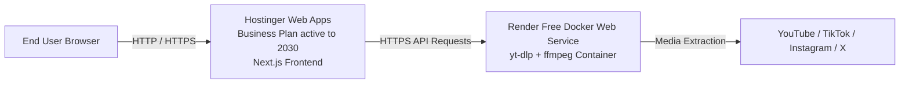

# 🚀 Hostinger Deployment Guide: DownLink Universal Downloader

This guide details how to deploy **DownLink** with **$0 extra server cost** using your active **Hostinger Business Plan (Web Apps)**:
- **Frontend:** Hosted on your **Hostinger Business Plan** via **Web Apps** (Node.js/Next.js) directly from GitHub or File Manager.
- **Backend:** Hosted on **Render's Free Docker Tier** (or Koyeb / HuggingFace Spaces) where `yt-dlp` and `ffmpeg` run in a full container environment with zero subscription fees.
- **Connection:** Hostinger Frontend calls the Render Backend via `NEXT_PUBLIC_API_BASE_URL=https://your-backend.onrender.com`.

---

## 🏗️ Architecture Overview (Zero-Cost Setup)



---

## 🛠️ Step 1: Deploy the Backend on Render (100% Free Docker Tier)

Because Hostinger Business Web Hosting is a sandboxed Node.js environment without root access or `ffmpeg` / `yt-dlp` system packages, your backend runs in a free container on Render.

1. Go to [dashboard.render.com](https://dashboard.render.com/) (sign up for free with GitHub if you haven't).
2. Click **New +** ➔ **Blueprint** (or **Web Service**).
3. Connect your GitHub repository: `Downloader`.
4. Render will automatically detect [`render.yaml`](file:///Users/ashrafulasif/My%20projects/Downloader/render.yaml) from your repository:
   - **Environment:** Docker
   - **Root Directory:** `apps/backend`
   - **Plan:** Free
   - **Healthcheck Path:** `/api/status`
5. Click **Apply / Create Web Service**.
6. Render builds the Docker image (with Node 20, Python 3, `yt-dlp`, and `ffmpeg`) and provisions a free HTTPS URL:
   `https://downlink-backend-xxxx.onrender.com`
7. Test the backend in your browser or terminal:
   ```bash
   curl https://downlink-backend-xxxx.onrender.com/api/status
   ```
   Expected response: `{"tasks":[]}`.

---

## 📦 Step 2: Deploy Frontend on Hostinger Web Apps

You already have an active **Hostinger Business Plan** with **Web Apps** enabled (as seen in your hPanel dashboard).

### Option A: Direct GitHub Deployment (Recommended)
1. In your Hostinger hPanel, go to **Websites ➔ Web Apps**.
2. Click **+ Create site** (top right button).
3. Select **Node.js web app** ➔ choose **Import your Git repository**.
4. Authorize and select your GitHub repository `Downloader` (branch: `main`).
5. Configure the build parameters:
   - **Framework:** `Next.js`
   - **Node.js Version:** `20.x`
   - **Build Command:** `npm run build:frontend`
   - **Start Command:** `npm run start`
6. Add Environment Variables:
   - `NEXT_PUBLIC_API_BASE_URL` = `https://downlink-backend-xxxx.onrender.com` (your Render backend URL)
   - `NODE_ENV` = `production`
7. Click **Deploy**. Hostinger will build and assign you a live `*.hostingersite.com` address (or your custom domain) with free automated SSL.

---

### Option B: 1-Click Upload using `hostinger-frontend.zip`
If you prefer manual upload instead of GitHub webhook:
1. On your local machine, run:
   ```bash
   npm run package:hostinger -- --api-url=https://downlink-backend-xxxx.onrender.com
   ```
   *(This builds and compresses the standalone server into `hostinger-frontend.zip`).*
2. In Hostinger hPanel, go to **Files ➔ File Manager** ➔ open `public_html/`.
3. Upload and extract `hostinger-frontend.zip`.
4. Go to **Websites ➔ Node.js**:
   - **Application Root:** `public_html`
   - **Application Startup File:** `server.js`
   - **Node.js Version:** `20.x`
5. Click **Save & Restart**.

---

## 🔒 Step 3: Configure CORS on Backend

Once your Hostinger website is live (e.g. `https://downlink.hostingersite.com` or `https://yourdomain.com`):
1. In your Render Dashboard ➔ select `downlink-backend` ➔ **Environment**.
2. Set `CORS_ALLOW_ORIGIN` to your Hostinger frontend URL (e.g. `https://downlink.hostingersite.com`).
3. Click **Save Changes**.

---

## 🖥️ Alternative: Deploying on a VPS (If you upgrade later)

If you acquire a VPS in the future, you can run the entire backend container via Docker Compose:
ufw allow 10000/tcp
ufw status
```

### 1.5 Verify Backend Health
Test that the backend is responding from your local computer or terminal:
```bash
curl http://<YOUR_VPS_IP>:10000/api/status
```
Expected output:
```json
{"tasks":[]}
```

---

## 📦 Step 2: Package and Deploy Frontend to Hostinger

We have automated the Next.js standalone bundling so you don't need to manually configure dependencies in hPanel.

### 2.1 Package the Frontend on your Local Machine
Run the automated packager script, providing your VPS IP and port:

```bash
npm run package:hostinger -- --api-url=http://<YOUR_VPS_IP>:10000
```

> **Note:** If you later attach a domain (e.g. `https://api.yourdomain.com`), simply re-run:
> `npm run package:hostinger -- --api-url=https://api.yourdomain.com`

This script automatically creates a production-ready archive at the root of the project:  
📁 **`hostinger-frontend.zip`** (contains `server.js`, bundled production `node_modules`, `.next`, `public`, `.env.production`, and `.htaccess`).

---

### 2.2 Upload to Hostinger hPanel

1. Log into your **Hostinger Control Panel (hPanel)**.
2. Go to **Websites** ➔ click **Manage** on your domain.
3. Open **File Manager** (Files ➔ File Manager).
4. Navigate into your website root:
   - For main domain: `public_html/`
   - For subdomain: `domains/subdomain.yourdomain.com/public_html/`
5. Click **Upload** (top right icon) ➔ select `hostinger-frontend.zip`.
6. Right-click `hostinger-frontend.zip` ➔ select **Extract** ➔ extract directly into `public_html`.
7. Once extracted, you should see:
   - `server.js`
   - `.next/`
   - `public/`
   - `node_modules/`
   - `package.json`
   - `.htaccess`
   - `.env.production`
8. (Optional) You can delete the uploaded `.zip` file to save disk space.

---

### 2.3 Configure Node.js in Hostinger hPanel

1. In hPanel, use the search bar or navigate to **Advanced** ➔ **Node.js** (or **Websites** ➔ **Node.js**).
2. Click **Create Application** (or Edit existing):
   - **Node.js Version:** `20.x` (or `22.x` LTS).
   - **Application Mode:** `Production`.
   - **Application Root:** `public_html` (or your subdomain folder).
   - **Application Startup File:** `server.js`.
3. In **Environment Variables** (if available in your hPanel):
   - Add: `PORT=3000`
   - Add: `NODE_ENV=production`
4. Click **Save** / **Restart Application**.

---

## 🔒 Step 3: CORS & Network Verification

1. In your backend `docker-compose.yml` on the VPS, verify `CORS_ALLOW_ORIGIN`:
   - During direct IP testing: keep `CORS_ALLOW_ORIGIN=*` (already configured by default).
   - Once your Hostinger domain is active: update `CORS_ALLOW_ORIGIN=https://your-hostinger-domain.com` and run `docker compose up -d`.
2. Visit your Hostinger website in your browser: `http://your-hostinger-domain.com` (or preview URL).
3. Paste a test video URL (e.g. YouTube or Instagram).
4. Verify that format detection, live progress streaming, and download file generation succeed.

---

## 💡 Troubleshooting & Common Questions

### 1. `server.js` fails to start on Hostinger
- Ensure you extracted the files so `server.js` is at the **top level** of `public_html/`, not nested in an extra folder.
- Check the Node.js logs in hPanel under **Node.js ➔ Application Logs**.

### 2. Frontend shows "Network Error" or "Failed to connect to backend"
- Verify that your VPS firewall allows port `10000` (`ufw allow 10000/tcp`).
- If your Hostinger frontend uses `https://`, modern browsers block mixed-content requests to `http://<VPS_IP>:10000`. You must either:
  - Access the frontend via `http://` for initial IP testing, OR
  - Point a DNS subdomain (e.g. `api.yourdomain.com`) to your VPS IP and run Certbot/Nginx on the VPS for SSL.

### 3. YouTube Download Restrictions
- To enable authenticated YouTube downloads (prevent bot detection), place your exported `youtube.cookies.txt` into the `./secrets/` directory on your VPS. The Docker container mounts this directory automatically.

