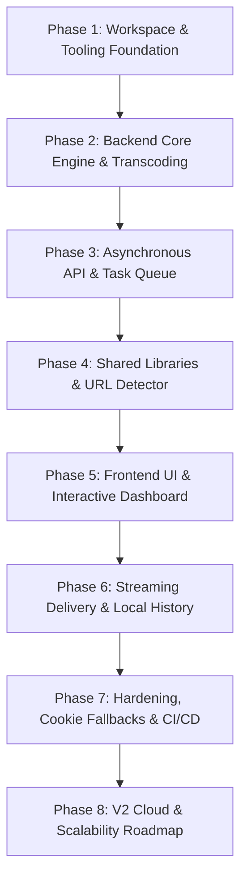

# Implementation Plan & Development Roadmap — DownLink

**Project:** DownLink Monorepo  
**Orchestration:** Turborepo (`apps/frontend`, `apps/backend`, `packages/shared`)  
**Status:** Approved Roadmap  

---

## 1. Development Methodology & Phasing Strategy

To ensure seamless AI-assisted development ("vibe coding"), implementation is structured into strictly ordered, verifiable phases. No feature is built before its foundational dependencies exist.

---

## 2. Detailed Milestones & Tasks

### Phase 1: Workspace & Tooling Foundation (Status: Completed)
- [x] **Task 1.1:** Setup Turborepo monorepo with npm workspaces (`apps/*`, `packages/*`).
- [x] **Task 1.2:** Configure root `package.json`, root `turbo.json` with pipeline definitions (`build`, `dev`, `lint`, `clean`).
- [x] **Task 1.3:** Setup `.github/workflows/ci.yml` for continuous integration on push/PR.
- [x] **Task 1.4:** Reorganize `apps/backend` and `apps/frontend` with clean `.gitignore` rules.
- **Verification:** Root `npm run lint` and `npm run build` run across all workspaces with `FULL TURBO` caching.

---

### Phase 2: Backend Core Engine & Transcoding (Status: Completed)
- [x] **Task 2.1:** Configure container `Dockerfile` (`node:20-bookworm-slim`) with native runtime dependencies: `ffmpeg`, `python3`, and `yt-dlp`.
- [x] **Task 2.2:** Build `apps/backend/src/lib/downloader.js` to manage `child_process.spawn` execution for `yt-dlp`.
- [x] **Task 2.3:** Implement stdout stream parser for capturing real-time progress percentages, speeds (`MB/s`), and ETAs.
- [x] **Task 2.4:** Implement automatic video/audio format merging via `ffmpeg` (e.g., merging 1080p video with best audio).
- **Verification:** Running standalone `node` test script downloads and muxes a test video into `DOWNLOAD_DIR`.

---

### Phase 3: Asynchronous API & Task Queue (Status: Completed)
- [x] **Task 3.1:** Implement in-memory task store in `apps/backend/src/lib/tasks.js` (`createTask`, `updateTask`, `getTask`, `cancelTasksBySession`).
- [x] **Task 3.2:** Build `POST /api/formats` endpoint to extract available resolutions and audio streams without downloading.
- [x] **Task 3.3:** Build `POST /api/download` to spawn background extraction and return `taskId` with `status: "pending"`.
- [x] **Task 3.4:** Build `GET /api/status/:taskId` for real-time client polling.
- [x] **Task 3.5:** Build `POST /api/download/cancel` and `POST /api/download/cancel-session` for process termination.
- [x] **Task 3.6:** Implement CORS origin middleware (`apps/backend/src/lib/cors.js`).
- **Verification:** Endpoints respond with valid JSON payloads and proper CORS headers via `curl`.

---

### Phase 4: Shared Libraries & URL Detection (Status: Completed)
- [x] **Task 4.1:** Create `packages/shared` (`@downloader/shared`) exporting platform regex patterns (`PATTERNS`) and `normalizeUrl`.
- [x] **Task 4.2:** Support platform detection for YouTube, Instagram, TikTok, Facebook, X/Twitter, and direct links.
- [x] **Task 4.3:** Link `@downloader/shared` into `apps/frontend` and `apps/backend` dependencies.
- **Verification:** Both frontend and backend share identical URL validation tests without duplicating code.

---

### Phase 5: Frontend UI & Interactive Dashboard (Status: Completed)
- [x] **Task 5.1:** Establish cybernetic dark design system in `apps/frontend/src/app/globals.css` (emerald `#10b981` accents, `#0a0a0b` background).
- [x] **Task 5.2:** Build `LinkInput.jsx` with real-time platform badge rendering, auto-paste, and clear controls.
- [x] **Task 5.3:** Build `PreviewCard.jsx` displaying video thumbnail, title, channel name, and duration.
- [x] **Task 5.4:** Build `QualitySelector.jsx` with tabbed format selector (1080p, 720p, 480p, 360p, MP3, M4A).
- [x] **Task 5.5:** Build `DownloadQueue.jsx` with animated progress bars, live transfer speed, and Cancel button.
- **Verification:** Frontend renders cleanly with 0 console errors and responsive layout across mobile and desktop.

---

### Phase 6: Streaming Delivery & Local History (Status: Completed)
- [x] **Task 6.1:** Build `GET /api/file/:taskId` using Node.js readable streams (`fs.createReadStream`) with `Content-Disposition`.
- [x] **Task 6.2:** Trigger automatic client-side file save when download progress hits 100%.
- [x] **Task 6.3:** Build `useHistory.js` and `HistoryTable.jsx` to persist completed downloads in `localStorage` (`downlink_history_v1`).
- [x] **Task 6.4:** Implement Re-download action from history and Clear History modal.
- **Verification:** Full cycle test: paste URL -> select 1080p -> download -> file saves to disk -> item appears in history table.

---

### Phase 7: Hardening, Cookie Fallbacks & Deployment (Status: Active / Next Steps)
- [x] **Task 7.1:** Configure Render deployment blueprint (`render.yaml`) pointing to `apps/backend` with Docker environment.
- [x] **Task 7.2:** Implement cookie fallback loading (`/etc/secrets/youtube.cookies.txt`, base64 environment variables) in `downloader.js` to mitigate platform bot checks.
- [x] **Task 7.3:** Implement cold-start detector in `apiClient.js` with auto-retry banner for Render free-tier wakeups.
- [ ] **Task 7.4:** Run cross-stack security audit for command injection prevention and SSRF validation.
- [ ] **Task 7.5:** Deploy `apps/frontend` to Vercel and verify production CORS handshake with Render backend.
- **Verification:** Production deployments live on Vercel and Render, successfully downloading media end-to-end.

---

### Phase 8: V2 Cloud & Scalability Roadmap (Future)
- [ ] **Task 8.1:** Replace in-memory task map with Redis + BullMQ for multi-worker container scaling.
- [ ] **Task 8.2:** Implement user authentication (Google / GitHub OAuth via Auth.js / NextAuth).
- [ ] **Task 8.3:** Setup PostgreSQL with Prisma ORM for synced cross-device download histories.
- [ ] **Task 8.4:** Cloud export integrations (Direct upload to Google Drive, Dropbox, AWS S3).
- [ ] **Task 8.5:** Stripe subscription integration for high-priority queue processing.

---

## 3. Definition of Done (DoD) for MVP (v1.0)

A task or feature is considered "Done" only when:
1. **TypeScript / ESLint Clean:** `npm run lint` passes across all packages with 0 warnings or errors.
2. **Build Verification:** `npm run build` succeeds locally and in GitHub Actions CI.
3. **No Dead Ends:** Error, loading, empty, and success states are explicitly handled in the UI.
4. **Security Verified:** No user input is passed directly to an unescaped shell execution.
5. **Documentation Updated:** `tracker.md` is updated to reflect the completed state.

