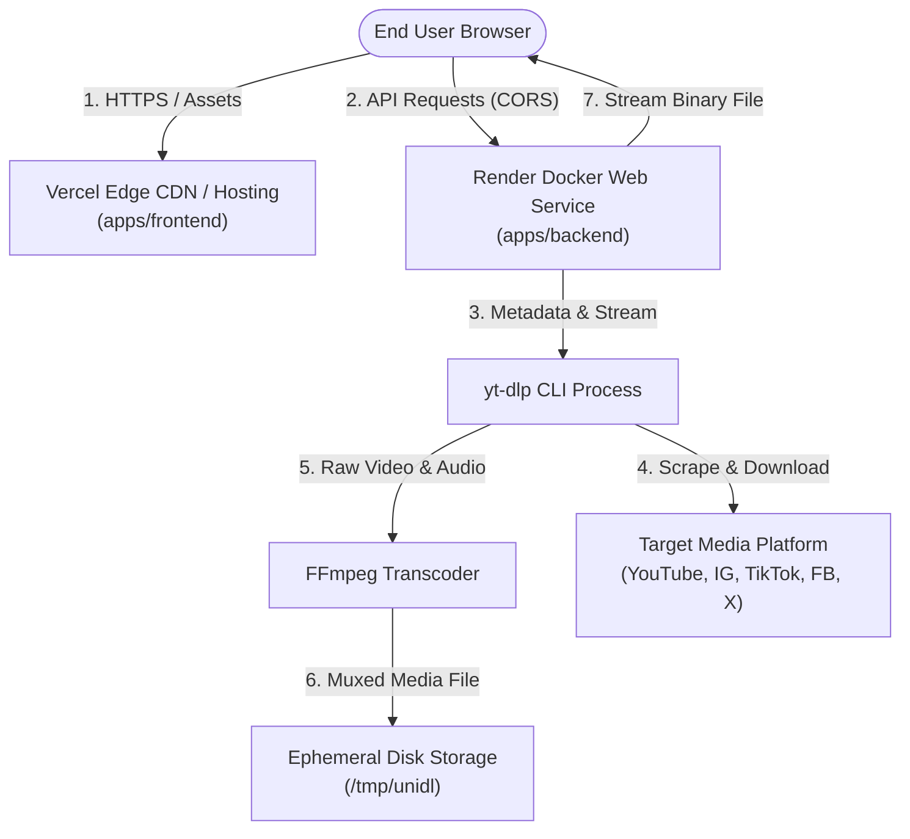

# Technical Requirements Document (TRD) — DownLink

**Project:** DownLink Monorepo  
**Architecture:** Distributed Decoupled Monorepo (Next.js Frontend + Next.js/Node Container Backend)  
**Status:** Approved Technical Architecture  

---

## 1. System Architecture Overview

DownLink employs a decoupled monorepo architecture orchestrated with **Turborepo** and **npm workspaces**. The frontend is an optimized static/edge-rendered Next.js client deployed on Vercel, and the backend is a containerized Next.js/Node.js service deployed on Render running native binaries (`yt-dlp` and `ffmpeg`).



---

## 2. Technology Stack & Justifications

| Layer | Technology | Version | Justification |
|---|---|---|---|
| **Monorepo Manager** | Turborepo | `^2.4.4` | High-speed build orchestration, smart task hashing, zero-config local caching, native support for npm workspaces. |
| **Workspace Runtime** | Node.js | `20-bookworm-slim` | Long-Term Support (LTS), broad binary package compatibility on Linux containers. |
| **Frontend Framework** | Next.js (App Router) | `16.1.6` | React 19 support, superior asset optimization, fast edge delivery on Vercel, robust client-side routing. |
| **Frontend UI Library** | React | `19.2.3` | Modern hooks, seamless state concurrency, fast DOM diffing. |
| **Styling Approach** | CSS Variables + Modular CSS | Vanilla CSS3 | Zero runtime overhead, clean custom design token architecture, no external CSS dependency lock-in. |
| **Backend Framework** | Next.js API Routes / Node.js | `16.1.6` | Lightweight HTTP routing, unified JS/TS ecosystem across the monorepo, streamlined container packaging. |
| **Extraction Engine** | `yt-dlp` | Latest stable | The gold standard open-source CLI for multi-platform media extraction; actively maintained against platform anti-bot changes. |
| **Transcoding Engine** | `ffmpeg` | `Bookworm native` | Essential for remuxing high-definition separate DASH video and audio tracks (e.g., 1080p/4K YouTube streams) into single `.mp4` containers. |
| **Shared Package** | `@downloader/shared` | `0.1.0` | Eliminates duplicated URL detection regexes and cross-app logic between frontend and backend. |

---

## 3. Frontend Architecture (`apps/frontend`)

### 3.1 Component Hierarchy & Structure
The frontend application lives in `apps/frontend/src` and is structured as a client-side reactive dashboard:

```
apps/frontend/src/
├── app/
│   ├── layout.js              # Global HTML shell, metadata, favicon, font imports
│   ├── page.js                # Core controller: state orchestration, tabs, polling
│   ├── globals.css            # Global CSS variables, reset, layout grids, keyframes
│   └── page.module.css        # Scoped layout styles
├── components/
│   ├── LinkInput.jsx          # Input bar with auto-paste, clear, and platform badge
│   ├── PreviewCard.jsx        # Thumbnail preview, duration badge, title display
│   ├── QualitySelector.jsx    # Tabbed format picker (Video qualities vs Audio only)
│   ├── DownloadQueue.jsx      # Live active tasks, progress bar, speed, ETA, Cancel
│   ├── HistoryTable.jsx       # Local download history table with re-download & clear
│   └── Toast.jsx              # Toast notification system for alerts and errors
├── hooks/
│   ├── useDownload.js         # Task polling manager with exponential backoff & retry
│   └── useHistory.js          # Synchronous localStorage adapter for download records
└── lib/
    ├── apiClient.js           # API route builder with base URL resolution & diagnostics
    └── detector.js            # Re-exported platform regex matching utilities
```

### 3.2 State Management
- **URL & Detection State:** Managed via React local state in `page.js`. Changing input triggers non-blocking regex detection against `PATTERNS`.
- **Formats & Preview State:** Cached per URL to avoid redundant network queries if the user switches quality tabs.
- **Queue State:** Array of active tasks tracked by their unique `taskId`. Each item manages its own progress, transfer speed, and cancellation signal.
- **Persistent State:** Managed by `useHistory`, backed by `window.localStorage` with schema versioning.

---

## 4. Backend Architecture (`apps/backend`)

### 4.1 Modular Engine & Process Execution
The backend is designed as an asynchronous task runner:

```
apps/backend/src/
├── app/api/
│   ├── detect/route.js        # POST: Quick platform & URL normalization
│   ├── formats/route.js       # POST: yt-dlp metadata & format extraction
│   ├── download/
│   │   ├── route.js           # POST: Spawn background task, return taskId
│   │   ├── cancel/route.js    # POST: Cancel individual taskId
│   │   └── cancel-session/    # POST: Abort all tasks for a sessionId
│   ├── status/
│   │   ├── route.js           # GET: Server health & resource diagnostics
│   │   └── [taskId]/route.js  # GET: Poll single task progress & status
│   └── file/[taskId]/route.js # GET: Binary streaming delivery of media file
└── lib/
    ├── tasks.js               # In-memory global task store & canceler registry
    ├── downloader.js          # Child process spawner, stdout parser, cleanup runner
    ├── detector.js            # Server-side URL validation & sanitization
    ├── cors.js                # Dynamic CORS origin header injector
    ├── errors.js              # Standardized API error response formatters
    └── requestLog.js          # Structured console logger (IP-redacted)
```

### 4.2 Process Execution & Safety
Commands are never invoked via `child_process.exec(shellString)`. All execution strictly utilizes `child_process.spawn`:
```javascript
const child = spawn("yt-dlp", args, {
  env: { ...process.env, PYTHONUNBUFFERED: "1" },
  stdio: ["ignore", "pipe", "pipe"],
});
```
This design prevents shell injection vulnerabilities by ensuring flags, options, and URLs are isolated as distinct argument array elements.

---

## 5. API Design & Communication Conventions

### 5.1 Communication Protocols
- **Format:** All API endpoints consume and produce `application/json`, except `GET /api/file/:taskId` which returns `application/octet-stream` or media-specific MIME types (e.g., `video/mp4`, `audio/mpeg`).
- **CORS Configuration:** Controlled via `CORS_ALLOW_ORIGIN` environment variable. Automatically handles pre-flight `OPTIONS` requests and returns credentials/allowed-methods headers.

### 5.2 API Specifications

#### `POST /api/detect`
- **Request:** `{ "url": "https://www.youtube.com/watch?v=..." }`
- **Response:**
  ```json
  {
    "platform": "youtube",
    "normalizedUrl": "https://www.youtube.com/watch?v=...",
    "supported": true
  }
  ```

#### `POST /api/formats`
- **Request:** `{ "url": "https://www.youtube.com/watch?v=..." }`
- **Response:**
  ```json
  {
    "title": "Sample Video Title",
    "thumbnail": "https://i.ytimg.com/vi/.../maxresdefault.jpg",
    "duration": 245,
    "uploader": "Creator Name",
    "formats": [
      {
        "formatId": "137+140",
        "ext": "mp4",
        "resolution": "1920x1080",
        "height": 1080,
        "filesize": 45210980,
        "note": "1080p (video+audio)"
      }
    ]
  }
  ```

#### `POST /api/download`
- **Request:** `{ "url": "...", "format": "137+140", "sessionId": "sess_abc123" }`
- **Response:**
  ```json
  {
    "taskId": "task_1710000000_a1b2c3",
    "status": "pending",
    "message": "Download task queued successfully"
  }
  ```

#### `GET /api/status/:taskId`
- **Response:**
  ```json
  {
    "id": "task_1710000000_a1b2c3",
    "status": "downloading",
    "progress": 64.2,
    "speed": "4.8 MB/s",
    "eta": "00:15",
    "filePath": null,
    "error": null
  }
  ```

#### `GET /api/file/:taskId`
- **Response:** Binary Stream (`200 OK`)
- **Headers:**
  - `Content-Disposition: attachment; filename="Sample_Video_Title.mp4"`
  - `Content-Type: video/mp4`
  - `Content-Length: 45210980`

---

## 6. Database & Storage Architecture

### 6.1 Database Strategy (MVP vs Production V2)
- **MVP (Current):**
  - **Task Store:** Backed by `globalThis.__downlink_tasks_store__` (`Map<string, Task>`). Provides zero-latency reads/writes without external database operational dependencies.
  - **Client History:** Stored in browser `localStorage` under `downlink_history_v1`.
- **Production (V2 Roadmap):**
  - **Distributed Task Queue:** Redis + BullMQ for distributed job dispatching across container worker replicas.
  - **Persistent History Database:** PostgreSQL with Prisma ORM for registered user accounts, cross-device sync, and download usage analytics.

### 6.2 Ephemeral File Storage Strategy
- Files are saved directly to `DOWNLOAD_DIR` (defaults to `/tmp/unidl` inside Docker).
- **Automated Eviction:**
  1. Once `GET /api/file/:taskId` finishes streaming, the file is scheduled for deletion.
  2. A scheduled disk cleanup routine sweeps `/tmp/unidl` every 15 minutes, removing any media file older than 30 minutes (`mtimeMs < Date.now() - 30 * 60 * 1000`).

---

## 7. Security Architecture & Threat Mitigation

### 7.1 Server-Side Request Forgery (SSRF) Prevention
Incoming URLs must be validated before invocation. URLs resolving to loopback (`127.0.0.1`, `localhost`), internal subnets (`10.0.0.0/8`, `172.16.0.0/12`, `192.168.0.0/16`), or cloud metadata endpoints (`169.254.169.254`) are rejected immediately with HTTP `400 Bad Request`.

### 7.2 Path Traversal Prevention
When resolving downloaded filenames on disk, paths are verified using `path.resolve` and checked against `DOWNLOAD_DIR`:
```javascript
const resolved = path.resolve(DOWNLOAD_DIR, filename);
if (!resolved.startsWith(path.resolve(DOWNLOAD_DIR))) {
  throw new Error("Invalid file path traversal attempt");
}
```

### 7.3 Secrets & Cookie Isolation
- Platforms requiring authenticated cookies (e.g., YouTube bot protection bypass) load cookies from:
  1. `/etc/secrets/youtube.cookies.txt` (Render Secret File)
  2. Local `secrets/youtube.cookies.txt` (excluded by `.gitignore`)
  3. `YTDLP_COOKIES_BASE64` environment variable fallback
- Cookie files are never accessible via any public HTTP route handler.

---

## 8. Deployment & Environment Configuration

### 8.1 Environments

| Parameter | Local Development | Staging / Preview | Production |
|---|---|---|---|
| **Frontend Host** | `localhost:3000` | Vercel Preview Deployments | Vercel (`https://down-link.vercel.app`) |
| **Backend Host** | `localhost:10000` | Render Preview Service | Render (`https://downlink-backend.onrender.com`) |
| **Backend Image** | Host Node.js | Docker | Docker (`node:20-bookworm-slim`) |

### 8.2 Environment Variables

#### Frontend (`apps/frontend/.env.local`)
- `NEXT_PUBLIC_API_BASE_URL`: Full base URL of the backend (e.g., `https://downlink-backend.onrender.com`).

#### Backend (`apps/backend/.env`)
- `NODE_ENV`: `production` or `development`
- `PORT`: `10000` (Render default)
- `DOWNLOAD_DIR`: `/tmp/unidl`
- `CORS_ALLOW_ORIGIN`: Allowed frontend origins (comma-separated or single origin, e.g., `https://down-link.vercel.app`)
- `YTDLP_COOKIES_FILE`: Path to Netscape cookie file (optional)

---

## 9. Monitoring, Logging & Error Handling

### 9.1 Error Classification
Errors are normalized into standard HTTP error responses:
```json
{
  "error": "Human readable error description",
  "code": "INVALID_URL | EXTRACTION_FAILED | DOWNLOAD_TIMEOUT | PROCESS_ABORTED",
  "details": null
}
```

### 9.2 Cold-Start Handling
When hosted on Render free tier, backend instances spin down after inactivity. The frontend client catches network errors and HTTP `502/503/504` and displays a non-blocking banner:
> *"Backend service is waking up from sleep. This may take 20–40 seconds. Automatic retry in progress..."*

---

## 10. Performance & Scalability Considerations

1. **Direct Streaming vs Buffering:** `GET /api/file/:taskId` creates a Node `fs.createReadStream` piped into the HTTP response. Memory overhead is bounded to chunk buffer sizes (`~64KB`), regardless of whether the file is 10MB or 4GB.
2. **Process Throttling:** Concurrency limits on `spawn` calls ensure the backend does not exhaust CPU cores or saturate disk I/O when handling burst download requests.

