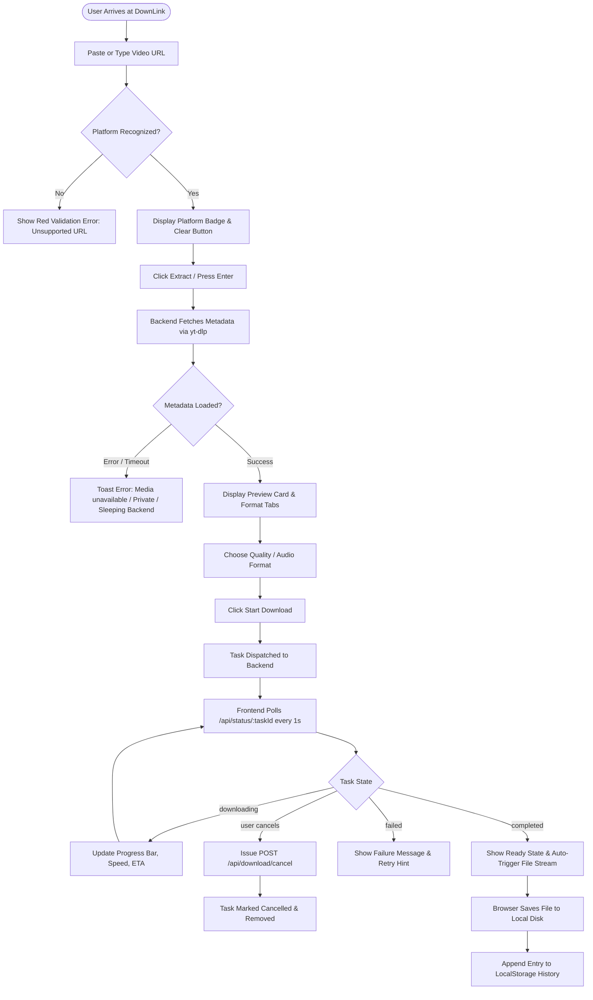
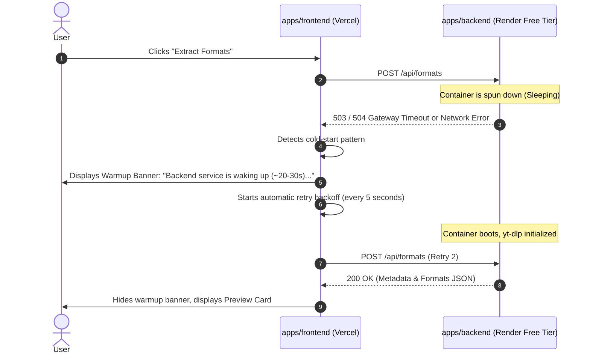

# User Journey & Application Flow — DownLink

**Project:** DownLink Monorepo  
**Status:** Approved User Flow & UX Architecture  

---

## 1. Application Screen Architecture

DownLink utilizes a streamlined, single-page application (SPA) dashboard layout designed for zero friction. There are no multi-step signups or complex menus. All functional components exist within an intuitive reactive interface:

```
┌─────────────────────────────────────────────────────────────┐
│                       DOWNLINK HEADER                       │
│           High-Speed Multi-Platform Media Extractor         │
├─────────────────────────────────────────────────────────────┤
│  [ https://youtube.com/watch?v=...     ] [Paste] [Extract]  │
│  (Platform Badge: YouTube / Instagram / TikTok / Direct)   │
├─────────────────────────────────────────────────────────────┤
│                     PREVIEW CARD                            │
│  [ Thumbnail ]  Title: Incredible 4K Drone Footage          │
│                 Channel: NatureHub • Duration: 04:32        │
├─────────────────────────────────────────────────────────────┤
│                  QUALITY & FORMAT SELECTOR                  │
│   [ Video Qualities (MP4) ]      [ Audio Only (MP3/M4A) ]   │
│   (●) 1080p (64.2 MB)  ( ) 720p (28.1 MB)  ( ) 480p        │
│   [ Start Download Button (Emerald Gradient) ]              │
├─────────────────────────────────────────────────────────────┤
│                     DOWNLOAD QUEUE                          │
│   [Progress Bar: 64%]  Speed: 4.8 MB/s  ETA: 00:15  [Cancel]│
│   [Download Ready! Click to Save]                           │
├─────────────────────────────────────────────────────────────┤
│                     DOWNLOAD HISTORY                        │
│   Date       Title                Quality   Size   Action   │
│   Today      Nature Drone Footage 1080p     64 MB  [Re-DL]  │
│   Yesterday  Tech Podcast #42     MP3       18 MB  [Re-DL]  │
│   [ Clear All History ]                                     │
└─────────────────────────────────────────────────────────────┘
```

---

## 2. End-to-End User Flow (Mermaid Flowchart)



---

## 3. Detailed User Journeys

### 3.1 First-Time User Journey (Frictionless Onboarding)
1. **Arrival:** User lands on `down-link.vercel.app`.
2. **Initial Perception:** Clean, high-contrast dark theme with emerald green accents. The URL input bar is automatically focused with placeholder text: *"Paste any YouTube, Instagram, TikTok, Facebook, or X link..."*.
3. **Clipboard Paste:** User clicks the **"Paste"** button or uses `Cmd+V` / `Ctrl+V`.
4. **Auto-Detection:** As soon as the URL hits the input, the regex detector recognizes the host domain and animates a platform icon (e.g., YouTube red badge or Instagram gradient icon).
5. **Metadata Render:** Within 1.5 seconds, the preview card smoothly appears with the video's thumbnail, title, channel name, and duration.
6. **One-Click Download:** User chooses the default recommended 1080p quality and clicks **"Start Download"**.
7. **Real-Time Assurance:** A progress card appears showing active downloading progress (`34%... 68%... 100%`) with live speed metrics (`5.2 MB/s`).
8. **File Saved:** The browser native save dialog pops up or saves directly to `~/Downloads/`.
9. **Delight:** Zero ads, zero popups, instant result.

### 3.2 Returning User Journey
1. **Returning Visit:** The user returns to download another video.
2. **History Pre-Loaded:** The bottom **"Download History"** section displays their past 10 downloads retrieved instantly from browser `localStorage`.
3. **Re-Download Capability:** If a file was misplaced or needs to be re-downloaded, the user can click **"Re-download"** next to any history entry, automatically pre-filling the URL and triggering fresh extraction.
4. **History Management:** User can clear individual history entries or click **"Clear History"** to wipe local storage.

---

## 4. Edge Cases & Exception Scenarios

### 4.1 Cold-Start / Sleeping Backend Handling


### 4.2 Geo-Restricted or Private Video
- **Trigger:** User pastes a link to a video that requires login, is age-gated without cookies, or is private/deleted.
- **Backend Response:** `yt-dlp` returns exit code with error string: `"Sign in to confirm your age"` or `"Video is private"`.
- **Frontend Presentation:**
  - Status card turns to subtle crimson (`--error: #f43f5e`).
  - Toast alert: *"This video is private, age-restricted, or blocked by the platform."*
  - The extract button is re-enabled to allow trying another URL.

### 4.3 Client Session Tab Close / Abandonment
- **Trigger:** User initiates a 2GB download and accidentally closes the browser tab or refreshes the page.
- **Mechanism:**
  - Frontend triggers `window.addEventListener("beforeunload")` sending a `navigator.sendBeacon` or synchronous `fetch` to `/api/download/cancel-session` with the client's `sessionId`.
  - The backend retrieves all running child processes registered to that `sessionId` and sends `SIGKILL` to `yt-dlp` and `ffmpeg`, freeing server CPU and memory immediately.

### 4.4 Network Interruption During Polling
- **Trigger:** User's Wi-Fi drops momentarily while a download is running.
- **Mechanism:**
  - `useDownload` hook encounters a fetch network error.
  - Instead of instantly failing the task, it switches into retry mode (3 consecutive retries with exponential backoff: 1s, 2s, 4s).
  - If network reconnects, polling resumes seamlessly.
  - If connection fails for >15 seconds, the task displays a **"Connection Lost — Reconnect & Retry"** button.

---

## 5. Screen State Matrix

| State Type | Visual Presentation | User Action Available |
|---|---|---|
| **Empty State** | Clean input bar with platform support pills (YT, IG, TikTok, FB, X) | Paste URL or type |
| **Typing / Validating** | Instant platform badge appears inside the input right-aligned | Press Enter or click Extract |
| **Fetching Metadata** | Skeleton shimmer on the preview container; button shows spinning loader | Input disabled temporarily |
| **Ready for Download** | Thumbnail, duration, title displayed; format buttons active | Switch format, click Download |
| **Active Downloading** | Emerald animated progress bar, speed indicator (`MB/s`), ETA countdown | Click "Cancel" to abort |
| **Download Complete** | Green checkmark, "Downloading to disk...", auto-triggered file download | "Download Again" or clear |
| **Error / Failure** | Red alert banner with actionable explanation and retry button | Click Retry or enter new URL |
| **History Empty** | Subdued text: *"No recent downloads. Links you extract will appear here."* | N/A |
| **History Populated** | Compact data table with platform icons, titles, dates, file sizes | Re-download or Clear History |

