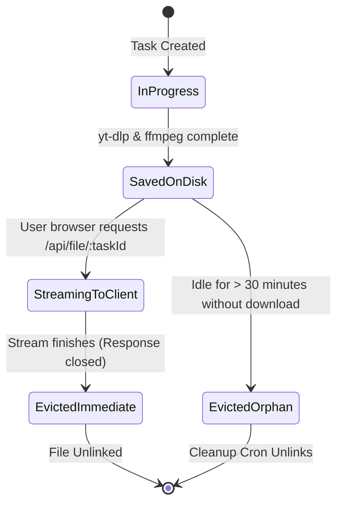

# Database Schema & Data Models — DownLink

**Project:** DownLink Monorepo  
**Storage Paradigms:**
1. **MVP Phase (In-Memory + LocalStorage):** Ephemeral Node.js Process Map (`globalThis`) + Browser `localStorage`.
2. **Production V2 Phase (Relational + Queue):** PostgreSQL (via Prisma ORM) + Redis (via BullMQ).
**Status:** Approved Data Model  

---

## 1. Storage Architecture Rationale

DownLink is purposely architected with a bifurcated storage model:
- **Zero-Persistence Privacy:** Anonymous users do not want their video download history logged permanently on a central server.
- **High-Velocity Ephemeral Tasks:** Download tasks change state multiple times per second (progress, speed, ETA). Writing high-frequency progress ticks to a relational database creates unnecessary I/O write amplification.
- **Local Client Control:** By storing user history in the browser's `localStorage`, users retain full control to inspect, export, or clear their data instantly without GDPR/privacy compliance overhead.

---

## 2. In-Memory Task Store Schema (`apps/backend/src/lib/tasks.js`)

In the Node.js backend runtime, active tasks are stored in a memory-efficient `Map<string, Task>` attached to `globalThis.__downlink_tasks_store__`.

### Entity: `Task`

| Field | Type | Required | Default | Description |
|---|---|---|---|---|
| `id` | `String` (PK) | Yes | `task_${timestamp}_${rand}` | Unique task identifier |
| `url` | `String` | Yes | — | Normalized media URL requested |
| `platform` | `String` | No | `null` | Detected platform (`youtube`, `instagram`, etc.) |
| `title` | `String` | No | `null` | Extracted title of the media |
| `thumbnail` | `String` | No | `null` | HTTP URL to media thumbnail |
| `format` | `String` | Yes | `"best"` | Selected `yt-dlp` format selector (e.g., `137+140`) |
| `status` | `String` | Yes | `"pending"` | Enum: `"pending"`, `"downloading"`, `"completed"`, `"failed"`, `"cancelled"` |
| `progress` | `Number` | Yes | `0` | Download completion percentage (`0.0` to `100.0`) |
| `speed` | `String` | No | `null` | Human-readable transfer rate (e.g., `"5.4 MB/s"`) |
| `eta` | `String` | No | `null` | Estimated time remaining (e.g., `"00:18"`) |
| `filePath` | `String` | No | `null` | Absolute path to downloaded file on server disk |
| `fileSize` | `Number` | No | `null` | Final file size in bytes |
| `error` | `String` | No | `null` | Diagnostic error message if status is `"failed"` |
| `sessionId` | `String` | No | `null` | Client browser session identifier |
| `createdAt` | `ISO8601` | Yes | `new Date().toISOString()` | Task creation timestamp |
| `updatedAt` | `ISO8601` | Yes | `new Date().toISOString()` | Last state or progress update |

#### JSON Example:
```json
{
  "id": "task_1710000000_a1b2c3",
  "url": "https://www.youtube.com/watch?v=dQw4w9WgXcQ",
  "platform": "youtube",
  "title": "Rick Astley - Never Gonna Give You Up (Official Music Video)",
  "thumbnail": "https://i.ytimg.com/vi/dQw4w9WgXcQ/maxresdefault.jpg",
  "format": "137+140",
  "status": "downloading",
  "progress": 68.4,
  "speed": "4.8 MB/s",
  "eta": "00:12",
  "filePath": "/tmp/unidl/Rick_Astley_Never_Gonna_Give_You_Up.mp4",
  "fileSize": 45210980,
  "error": null,
  "sessionId": "sess_8f3d1b",
  "createdAt": "2026-11-11T06:15:00.000Z",
  "updatedAt": "2026-11-11T06:15:18.000Z"
}
```

---

## 3. Client-Side History Schema (`downlink_history_v1`)

Stored in the client's browser under key `downlink_history_v1` as a JSON array of `HistoryItem` records (capped at the 50 most recent items).

### Entity: `HistoryItem`

| Field | Type | Required | Description |
|---|---|---|---|
| `id` | `String` (PK) | Yes | Unique ID generated client-side (`hist_${timestamp}_${rand}`) |
| `taskId` | `String` | Yes | Reference to original backend task |
| `url` | `String` | Yes | The source media URL |
| `title` | `String` | Yes | Display title of the video or track |
| `platform` | `String` | Yes | Platform badge identifier (`youtube`, `tiktok`, etc.) |
| `thumbnail` | `String` | No | Cached thumbnail URL for quick list display |
| `format` | `String` | Yes | Format identifier or quality label (`1080p`, `MP3`) |
| `fileSize` | `String` | No | Formatted size string (e.g., `"64.2 MB"`) |
| `timestamp` | `Number` | Yes | Unix epoch in milliseconds when download finished |

#### JSON Example:
```json
[
  {
    "id": "hist_1710000030_x9y8z7",
    "taskId": "task_1710000000_a1b2c3",
    "url": "https://www.youtube.com/watch?v=dQw4w9WgXcQ",
    "title": "Rick Astley - Never Gonna Give You Up",
    "platform": "youtube",
    "thumbnail": "https://i.ytimg.com/vi/dQw4w9WgXcQ/hqdefault.jpg",
    "format": "1080p MP4",
    "fileSize": "43.1 MB",
    "timestamp": 1710000030000
  }
]
```

---

## 4. Production V2 Relational Schema (PostgreSQL + Prisma)

For Version 2.0 when user accounts, cloud sync, and priority subscriptions are enabled:

```prisma
// datasource and generator definition
datasource db {
  provider = "postgresql"
  url      = env("DATABASE_URL")
}

generator client {
  provider = "prisma-client-js"
}

enum Role {
  USER
  PRO_USER
  ADMIN
}

enum TaskStatus {
  PENDING
  DOWNLOADING
  COMPLETED
  FAILED
  CANCELLED
}

model User {
  id            String         @id @default(cuid())
  email         String         @unique
  name          String?
  image         String?
  role          Role           @default(USER)
  createdAt     DateTime       @default(now())
  updatedAt     DateTime       @updatedAt
  downloads     DownloadLog[]
  subscriptions Subscription[]

  @@index([email])
}

model Subscription {
  id                   String   @id @default(cuid())
  userId               String
  user                 User     @relation(fields: [userId], references: [id], onDelete: Cascade)
  stripeCustomerId     String   @unique
  stripeSubscriptionId String   @unique
  status               String
  currentPeriodEnd     DateTime
  createdAt            DateTime @default(now())

  @@index([userId])
}

model DownloadLog {
  id          String     @id @default(cuid())
  userId      String?
  user        User?      @relation(fields: [userId], references: [id], onDelete: SetNull)
  url         String
  platform    String
  title       String
  duration    Int?
  format      String
  fileSize    BigInt?
  status      TaskStatus @default(PENDING)
  error       String?
  ipHash      String     // SHA-256 hashed for rate-limiting, no raw IP stored
  completedAt DateTime?
  createdAt   DateTime   @default(now())

  @@index([userId, createdAt])
  @@index([ipHash, createdAt])
}
```

---

## 5. File Lifecycle & Data Eviction Policy

Because video files occupy substantial disk space, strict TTL rules govern the physical filesystem:



1. **Immediate Post-Stream Deletion:** As soon as `GET /api/file/:taskId` emits the `finish` event on the response stream, the file is unlinked from disk:
   ```javascript
   res.on("finish", async () => {
     try { await fs.promises.unlink(filePath); } catch {}
   });
   ```
2. **Orphan Cleanup Sweeper:** Every 15 minutes, an internal background cleaner scans `/tmp/unidl/`. Any file with `stat.mtimeMs < Date.now() - 30 * 60 * 1000` is unlinked.
3. **Memory Task Pruning:** Completed or failed tasks in `globalThis.__downlink_tasks_store__` are automatically pruned from the Map after 1 hour to prevent memory bloat.
